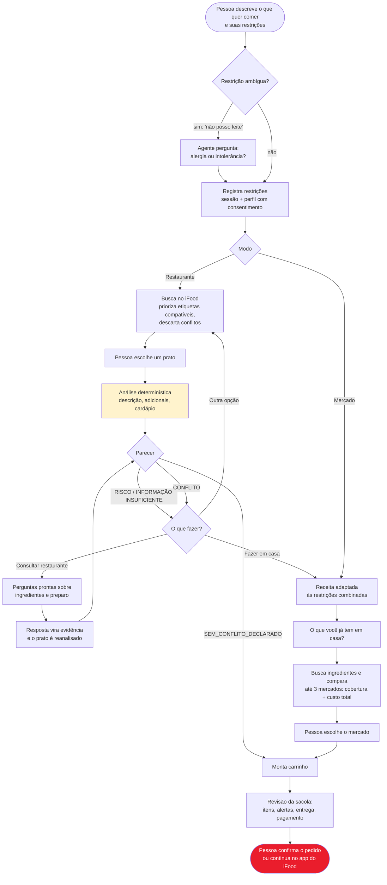
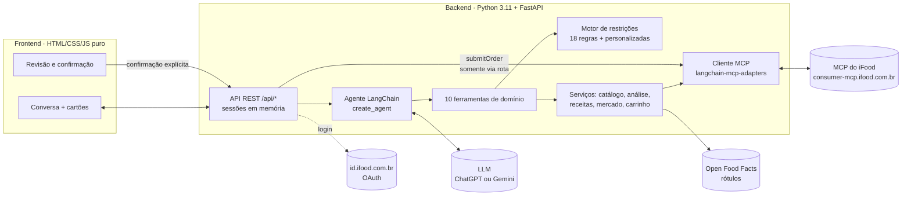

# Ailo — o agente do iFood para quem tem restrição alimentar

> **"Quero uma lasanha, mas tenho alergia à proteína do leite e sou celíaca."**
> Hoje essa pessoa abre dez cardápios, lê descrições incompletas e desiste. Com o Ailo, ela diz isso uma vez. O agente procura opções compatíveis perto dela, investiga cada prato, explica o que sabe e o que *não* sabe. Se nada servir, transforma o pedido numa receita adaptada com a lista de compras pronta no mercado do iFood.

Projeto do **Hackathon SEMCOMP × iFood 2026: Vendendo com Agentes**.

| | |
| --- | --- |
| **Para quem** | Pessoas com alergias, intolerâncias, doença celíaca, restrições religiosas ou dieta vegetariana/vegana. 18 restrições já vêm cadastradas, e o usuário pode criar outras. |
| **O que o agente faz** | Conversa, registra as restrições, busca no iFood, analisa cada produto com regras determinísticas, prepara perguntas para o restaurante, adapta receitas, compara mercados e monta o carrinho. |
| **O que é real** | Conta, endereço, busca, cardápios, preços, carrinhos e checkout vêm do **MCP oficial do iFood**, com o OAuth do agente. |
| **O que vem de fora** | Rótulos de industrializados vêm da Open Food Facts (pelo código de barras ou pelo nome e marca). As receitas adaptadas são propostas pela IA e validadas pelas regras. |
| **Princípio central** | A IA conversa e decide *quais ferramentas usar*. O parecer alimentar sai de regras auditáveis, e **quem confirma o pedido é sempre a pessoa**. |

---

## Sumário: onde encontrar cada entregável

| # | Entregável | Seção |
| --- | --- | --- |
| 01 | Proposta de Negócio | [Problema, público e proposta de valor](#01--proposta-de-negócio) |
| 02 | Desenho de Solução | [Fluxo geral e responsabilidades](#02--desenho-de-solução) |
| 03 | Racional da Experiência | [Decisões de UX e por quê](#03--racional-da-experiência) |
| 04 | Interface Visual | [Telas e como ver funcionando](#04--interface-visual) |
| 05 | Documento Técnico Resumido | [Arquitetura, MCP, execução e testes](#05--documento-técnico-resumido) |
| 06 | Feedback sobre os MCPs | [Resumo](#06--feedback-sobre-os-mcps) e [documento completo](docs/feedback-mcp.md) |

Atalhos: [como rodar](#como-rodar) · [roteiro de demonstração](#roteiro-de-demonstração) · [limitações](#limitações-conhecidas)

---

## 01 · Proposta de Negócio

### O problema

Para quem tem restrição alimentar, pedir comida exige investigar, e o app não ajuda nessa investigação:

- **A busca não responde à pergunta certa.** "Tem lasanha perto de mim?" é fácil. "Essa lasanha tem leite? O molho leva farinha de trigo? Fritam na mesma panela?" a busca não responde.
- **A informação existe pela metade.** Descrições curtas, sem lista de ingredientes nem aviso de "pode conter".
- **As restrições se combinam.** Quem é celíaco *e* tem APLV não consegue usar dois filtros ao mesmo tempo sem perder opções válidas (detalhe em [feedback do MCP](docs/feedback-mcp.md), item 4).
- **Rótulos confundem.** "Zero lactose" parece servir para quem tem alergia ao leite, e não serve.
- **Quando nada serve, o pedido se perde.** A pessoa fecha o app e vai improvisar algo em casa, sem ajuda.

### A proposta de valor

> **O Ailo transforma "não sei se posso comer isso" em uma decisão informada: um prato compatível, uma pergunta pronta para o restaurante ou uma lista de compras adaptada. Tudo na mesma conversa.**

O diferencial é a **continuidade da decisão**. Concorrentes, e o próprio app hoje, param no filtro. O Ailo segue o caminho inteiro:

```
pedido → busca compatível → análise com evidências → dúvida? pergunta ao restaurante
                                                   → conflito? outra opção
                                                   → nada serve? receita adaptada → mercado → carrinho
```

### Valor para cada lado

| Para quem pede | Para o iFood | Para restaurantes e mercados |
| --- | --- | --- |
| Menos tempo investigando cardápios | **Recupera pedidos que seriam abandonados**, levando a pessoa do restaurante para o mercado | Clientes chegam com perguntas objetivas sobre preparo e contato cruzado |
| Explicação clara do motivo de cada parecer | Fidelização de um público que hoje confia pouco em apps de delivery | Demanda visível por informação alimentar estruturada |
| Restrições lembradas entre conversas (com consentimento) | Cesta maior no mercado: uma receita inteira em um carrinho | Mais vendas de produtos "sem" (sem glúten, vegano etc.) |

### Por que um agente (e não um filtro melhor)

Restrição alimentar é uma conversa, não uma checkbox. "Não posso comer leite" pode ser APLV ou intolerância à lactose, e cada caso leva a um parecer diferente. "Sou muçulmano" precisa ser confirmado como halal. Quando a primeira opção falha, o próximo passo depende do contexto. Um agente consegue perguntar o que falta, lembrar o que já foi dito e encadear as operações do MCP (buscar, detalhar, comparar, montar carrinho) sem que a pessoa navegue por dez telas.

### Como mediríamos o impacto

O protótipo valida a estrutura técnica, **mas não temos métricas de uso real**. Num piloto, acompanharíamos:

- taxa de conversão de buscas com restrição (com e sem o Ailo);
- pedidos "recuperados", em que a pessoa não achou prato pronto e comprou ingredientes;
- tempo até a primeira decisão;
- quantidade de conflitos que o agente evitou;
- compreensão dos alertas, medida em testes de usabilidade com o público-alvo.

---

## 02 · Desenho de Solução

### Fluxo geral



### Os dois fluxos em uma frase

1. **Restaurante:** encontra pratos compatíveis perto da pessoa, mostra só o que não conflita com as restrições, analisa o prato escolhido e, se houver dúvida, oferece três saídas: perguntar ao restaurante, escolher outro prato ou preparar em casa.
2. **Mercado (preparo em casa):** adapta a receita a *todas* as restrições ao mesmo tempo (por exemplo, panqueca sem leite, sem glúten e sem ovo), tira da lista o que a pessoa já tem, calcula quantas embalagens comprar e compara mercados por cobertura da lista e custo total com frete.

### Quem faz o quê

A decisão de arquitetura mais importante é **não deixar a LLM decidir se um alimento é compatível**.

| Responsabilidade | Quem executa | Por quê |
| --- | --- | --- |
| Entender o pedido, perguntar o que falta, escolher ferramentas, explicar o resultado | **LLM** (agente LangChain) | É o que a IA faz bem: linguagem natural e orquestração |
| Decidir se há conflito com a restrição | **Regras determinísticas** ([analisador](backend/ailo/restrictions/analyzer.py) + [catálogo de 18 restrições](docs/restricoes-alimentares.md)) | Precisa ser auditável e reproduzível; a LLM não pode "suavizar" um risco |
| Buscar, detalhar, montar carrinho | **MCP do iFood**, chamado pelos serviços do Ailo | Dados reais da conta, do endereço e das lojas |
| Confirmar e enviar o pedido | **A pessoa**, na tela de revisão | A LLM não tem acesso à ferramenta `submitOrder` |

O agente nunca chama o MCP diretamente. Ele recebe **10 ferramentas de domínio** (`analisar_produto`, `registrar_receita`, `montar_carrinho`…) que encapsulam o MCP e aplicam as travas de segurança. Detalhes na [seção técnica](#ferramentas-do-agente).

---

## 03 · Racional da Experiência

Cada decisão abaixo responde a uma dor concreta do público.

| Decisão | Por quê |
| --- | --- |
| **Uma conversa, não um formulário.** A pessoa escreve (ou dita, com o microfone) do jeito que falaria com um amigo. | Restrições são pessoais e cheias de nuance. Um formulário de 18 checkboxes não captura "sou celíaca e meu filho tem alergia a amendoim". |
| **O agente pergunta só o que muda o resultado.** "Não posso leite" vira: *é alergia à proteína ou intolerância à lactose?* | A resposta muda o parecer: zero lactose serve para um caso e é perigoso para o outro. Perguntas desnecessárias cansam. |
| **Cartões estruturados no lugar de paredes de texto.** Opções, parecer, receita, comparação de mercados e carrinho aparecem como cartões gerados pelos dados, não pelo texto da IA. | Preço, ingrediente e parecer não podem ser "alucinados". O texto do agente só comenta o que o cartão mostra. |
| **Quatro pareceres, não "seguro/inseguro".** `CONFLITO`, `RISCO`, `INFORMAÇÃO INSUFICIENTE`, `SEM CONFLITO DECLARADO`. | Honestidade gera confiança. "Não encontramos conflito nos dados" é diferente de "é seguro", e o público com alergia sabe disso. |
| **Toda dúvida tem uma saída.** O parecer sempre vem com próximos passos: consultar o restaurante, ver outra opção ou fazer em casa. | Um "não pode" sem alternativa vira pedido abandonado. |
| **Pergunta ao restaurante pronta para copiar.** Um botão gera perguntas específicas sobre ingredientes, preparo e contato cruzado, sem passar pela LLM. | Muita gente não sabe *o que* perguntar. O Ailo não finge que enviou a mensagem; quem envia é a pessoa. |
| **Trocas explicadas.** Na receita adaptada, cada substituição mostra o motivo culinário ("a linhaça hidratada dá liga como o ovo") e, separadamente, o que diz o rótulo do produto. | A pessoa entende e confia na adaptação, e aprende a repetir sozinha. |
| **"O que você já tem em casa?"** | Ninguém quer comprar sal e azeite de novo. A lista fica menor e o carrinho fica mais realista. |
| **Restrições lembradas, com consentimento.** O perfil é salvo localmente só após autorização e não é pedido de novo. | Repetir "sou celíaca" a cada pedido é cansativo, mas dado de saúde exige consentimento explícito. |
| **A pessoa tem a palavra final.** O agente monta o carrinho; a revisão mostra itens, alertas, entrega e pagamento, e só um clique dela envia o pedido. | Compra é uma ação com consequências, e alergia é uma questão de saúde. O controle não pode ficar com a IA. |
| **Aviso permanente:** "O Ailo apoia sua decisão, mas não substitui orientação médica". | Expectativa correta sobre o que um agente pode garantir. |

---

## 04 · Interface Visual

A interface é uma aplicação web executável, no estilo visual do iFood, servida pelo próprio backend. Depois de [rodar o projeto](#como-rodar), abra `http://localhost:5173`.

| Tela | Arquivo | O que mostra |
| --- | --- | --- |
| **Conversa com o Ailo** | [`index.html`](frontend/index.html) | Tela inicial com sugestões de pedido, alternância **Restaurantes / Mercado**, entrada por texto ou voz e cartões interativos na conversa |
| **Revisão do pedido** | diálogo em `index.html` + [`checkout.js`](frontend/checkout.js) | Itens, quantidades, alertas, endereço, entrega, pagamento, confirmação explícita e link para abrir o carrinho no app do iFood |
| **Perfil alimentar** | [`perfil.html`](frontend/perfil.html) | Restrições salvas, consentimento e exclusão do perfil |

**Cartões que o agente renderiza na conversa** ([`chat-cards.js`](frontend/chat-cards.js)):

| Cartão | Conteúdo |
| --- | --- |
| Restrições | O que foi entendido, com opção de salvar no perfil |
| Opções | Até 3 pratos compatíveis, com preço e indicação de etiqueta do iFood |
| Restaurantes | Lojas encontradas para o pedido |
| Análise | Parecer por restrição, evidências com origem, informações ausentes e botões de próximo passo |
| Consulta ao restaurante | Mensagem pronta com as perguntas, para copiar |
| Receita adaptada | Ingredientes, quantidades, trocas justificadas e produtos de referência |
| Comparação de mercados | Mercado recomendado, cobertura da lista, faltantes, frete e total |
| Carrinho | Itens, valores, alertas e acesso à revisão |

---

## 05 · Documento Técnico Resumido

### Arquitetura



Um único servidor entrega a interface e a API. Cada mensagem do usuário vira um turno do agente: a LLM recebe o histórico e o contexto da sessão (modo, restrições ativas, endereço) e chama as ferramentas necessárias, com limite de 10 rodadas por mensagem. As ferramentas devolvem **dois** resultados: um JSON compacto para a LLM e um **cartão** (`content_and_artifact` do LangChain) que vai direto para a interface, sem passar pelo texto do modelo.

### Stack

| Camada | Tecnologia |
| --- | --- |
| Agente | LangChain 1.x (`create_agent`), `langchain-mcp-adapters` |
| LLM | ChatGPT via OAuth da assinatura (padrão) **ou** Gemini via API key, alternáveis por `LLM_PROVIDER` |
| Backend | Python ≥ 3.11, FastAPI, Uvicorn, httpx, gerenciado com `uv` |
| Frontend | HTML, CSS e JavaScript sem framework e sem etapa de build |
| Integração | MCP do iFood (`consumer-mcp.ifood.com.br/marketplace`) com OAuth 2.0 |
| Testes | pytest + pytest-asyncio, com MCP e LLM simulados ([`tests/fakes.py`](backend/tests/fakes.py)) |

### Ferramentas do agente

As ferramentas estão registradas em [`agent/tools/__init__.py`](backend/ailo/agent/tools/__init__.py) e os prompts centralizados em [`agent/system_prompt.py`](backend/ailo/agent/system_prompt.py).

| Ferramenta | O que faz | MCP por trás |
| --- | --- | --- |
| `registrar_restricoes` | Resolve e guarda as restrições (catálogo ou personalizadas); invalida análises antigas se mudarem | — |
| `buscar_opcoes` | Busca pratos ou lojas; prioriza etiquetas do iFood, confere a descrição dos demais e descarta conflitos; sugere alternativas quando o pedido não tem opção compatível | `searchOffers`, `browseOffers` |
| `ver_cardapio_da_loja` | Lista itens de uma loja específica | `searchOffers` |
| `analisar_produto` | Parecer determinístico: descrição, declarações "sem", contradições, adicionais e cardápio (possível contato cruzado) | `getItem`, `browseOffers` |
| `preparar_mensagem_restaurante` | Gera perguntas para a pessoa enviar ao restaurante | — |
| `registrar_resposta_restaurante` | Usa a resposta do restaurante como evidência e refaz a análise | `getItem` |
| `registrar_receita` | Valida a receita adaptada contra as restrições; recusa se houver conflito | — |
| `buscar_ingredientes_no_mercado` | Busca cada ingrediente com e sem filtros, compara até 3 mercados e calcula embalagens | `searchOffers`, `getItem` |
| `montar_carrinho` | Cria carrinho de restaurante e **bloqueia itens com `CONFLITO`** | `createCart` |
| `montar_carrinho_do_mercado` | Cria o carrinho com o plano do mercado escolhido | `createCart` |

Fora do alcance da LLM, acionadas só pela interface: `getUser`, `listAddresses`, `getCart`, `getCartDeliveryMethods`, `listPaymentMethods`, `setCartDelivery`, `setCartPayment`, **`submitOrder`** e `trackOrder`.

### Decisões técnicas principais

1. **Regras determinísticas para o parecer.** O [catálogo de restrições](backend/ailo/restrictions/catalog.py) define, para cada uma, termos de conflito, termos de atenção, expressões ignoradas ("leite de coco" não é leite animal), declarações aceitas e declarações insuficientes ("zero lactose" não atende APLV). O [analisador](backend/ailo/restrictions/analyzer.py) normaliza acentos, trata negações e devolve evidências com origem. O documento [restrições alimentares](docs/restricoes-alimentares.md) é gerado a partir do código.
2. **`submitOrder` fora do alcance da IA.** O envio passa por `POST /api/orders`, que exige confirmação explícita, ciência dos alertas e `ALLOW_SUBMIT_ORDER` habilitado.
3. **Contornando o E lógico dos filtros do MCP.** Com várias restrições, o Ailo faz uma busca por filtro e mais uma sem filtro, e une os resultados, para não esconder produtos válidos.
4. **Ações determinísticas na interface.** "Consultar restaurante" gera as perguntas direto do resultado da análise, sem chamar a LLM nem o iFood. É mais rápido, mais barato e sem risco de alucinação.
5. **Quantidade de embalagens calculada.** A receita informa a necessidade em g/ml; o código lê o tamanho do produto encontrado e arredonda para cima (600 g em pacotes de 250 g = 3 pacotes).
6. **Rótulo do produto certo.** O rótulo é buscado pelo EAN; sem ele (o caso mais comum no iFood), pelo nome, exigindo que a marca também apareça no anúncio. Um produto parecido de outra marca nunca empresta o rótulo.
7. **Provedor de LLM trocável.** Só [`chat_model.py`](backend/ailo/agent/chat_model.py) conhece o provedor; o resto usa a interface padrão do LangChain.

### Opções para testes e apresentação

| Variável | Padrão | Efeito |
| --- | --- | --- |
| `INCLUDE_CLOSED_STORES` | `true` | Inclui lojas fechadas nas buscas, para testar a qualquer hora |
| `SIMULATE_LABEL_CHECK` | `true` | Produtos de mercado sem conflito nem risco aparecem com "rótulo verificado" (simulado, com aviso no cartão) |

> ⚠️ Desligue as duas (`false`) fora de testes e apresentações. Busca, preços e carrinhos usam sempre o iFood de verdade; para impedir o envio de pedidos, use `ALLOW_SUBMIT_ORDER=false`.

### Como rodar

**Pré-requisitos:** Python ≥ 3.11, [uv](https://docs.astral.sh/uv/), Node.js (só para os scripts `npm`), um agente cadastrado no [MCP Portal do iFood](https://mcp-developer.ifood.com.br) e uma conta de teste do iFood.

1. Crie um arquivo `.env` na raiz do repositório:

   ```ini
   LLM_PROVIDER=gemini
   CHATGPT_MODEL=gpt-5.6-terra

   GEMINI_API_KEY=
   GEMINI_MODEL=gemini-flash-latest

   IFOOD_CLIENT_ID=
   IFOOD_CLIENT_SECRET=
   IFOOD_REDIRECT_URI=http://localhost:8080/callback
   IFOOD_SCOPES=

   ALLOW_SUBMIT_ORDER=true

   PORT=5173

   IFOOD_MCP_URL=https://consumer-mcp.ifood.com.br/marketplace
   IFOOD_AUTHORIZE_URL=https://id.ifood.com.br/authorize
   IFOOD_TOKEN_URL=https://id.ifood.com.br/token
   IFOOD_REVOKE_URL=https://id.ifood.com.br/revoke

   INCLUDE_CLOSED_STORES=true
   SIMULATE_LABEL_CHECK=true
   ```

2. Instale, autentique e suba o servidor:

   ```bash
   npm run setup
   ```

   ```bash
   npm run login-chatgpt
   ```
   (só se `LLM_PROVIDER=chatgpt`)

   ```bash
   npm run dev
   ```

3. Abra `http://localhost:5173` e clique em **Conectar iFood** (ou rode `npm run login` no terminal).

<details>
<summary>Todas as variáveis de ambiente</summary>

| Variável | Padrão | Descrição |
| --- | --- | --- |
| `LLM_PROVIDER` | `chatgpt` | `chatgpt` (assinatura via OAuth) ou `gemini` (API key) |
| `CHATGPT_MODEL` | `gpt-5.6-terra` | Modelo usado com o provedor ChatGPT |
| `GEMINI_API_KEY` | — | Chave do Gemini ([AI Studio](https://aistudio.google.com/apikey)) |
| `GEMINI_MODEL` | `gemini-flash-latest` | Modelo do Gemini |
| `IFOOD_CLIENT_ID` / `IFOOD_CLIENT_SECRET` | — | Credenciais do agente no MCP Portal |
| `IFOOD_REDIRECT_URI` | `http://localhost:8080/callback` | Redirect URL do OAuth |
| `IFOOD_SCOPES` | padrão do iFood | Escopos separados por espaço |
| `IFOOD_MCP_URL` | `https://consumer-mcp.ifood.com.br/marketplace` | Endpoint do MCP |
| `INCLUDE_CLOSED_STORES` | `true` | Inclui lojas fechadas nas buscas (testes) |
| `SIMULATE_LABEL_CHECK` | `true` | Rótulo "verificado" simulado no mercado (apresentação) |
| `ALLOW_SUBMIT_ORDER` | `true` | Permite o envio do pedido após confirmação humana |
| `AGENT_MAX_TOOL_ROUNDS` | `10` | Limite de rodadas de ferramenta por mensagem |
| `PORT` | `5173` | Porta do servidor |
| `DATA_DIR` | `.data` | Pasta (em `backend/`) para tokens e perfil, fora do git |

> O provedor `chatgpt` usa uma integração **experimental e não oficial** do `langchain-openai` com o backend do Codex. Ela respeita os limites do plano e pode mudar sem aviso. Para uma execução mais previsível, use `gemini`.

</details>

### Testes

```bash
npm test
```

Oito arquivos de teste em [`backend/tests/`](backend/tests/) cobrem o analisador de restrições (APLV × lactose, negações, contradições, contato cruzado), a busca de ingredientes no mercado, a consulta de rótulos (EAN e nome), o cálculo de embalagens, as travas do carrinho e do perfil, o OAuth, a consulta ao restaurante, os prompts e o laço do agente. **O MCP e a LLM são simulados**, então os testes não substituem a homologação de pedidos reais no iFood. A sintaxe do frontend é verificada com `npm run check`.

### Estrutura do repositório

```
backend/ailo/
├── agent/            agente LangChain, provedores de LLM, prompts e as 10 ferramentas
├── restrictions/     catálogo de 18 restrições, analisador e mensagens ao restaurante
├── services/         catálogo, análise, mercado, nutrição, embalagens, carrinho, conta, rótulos
├── ifood/            cliente MCP e OAuth do iFood
├── api/routes.py     API REST consumida pela interface
├── data/             tabela nutricional de referência (TACO)
└── main.py           servidor (interface + API)
frontend/             interface web (conversa, cartões, revisão do pedido, perfil)
docs/                 restrições, mapa de funcionalidades, feedback do MCP
```

Material complementar: [mapa de funcionalidades do agente](docs/funcionalidades-agente.md).

---

## 06 · Feedback sobre os MCPs

Registramos as dificuldades reais que encontramos durante a integração. O documento completo, com 16 pontos, está em **[docs/feedback-mcp.md](docs/feedback-mcp.md)**. Os mais relevantes para quem mantém o MCP:

**Dados de produto (a maior dor para este caso de uso)**
- `getItem` promete "curated attributes (dietary, allergens, descriptors)", mas os itens consultados trazem só nome, descrição e adicionais. **Não há ingredientes nem alergênicos estruturados.**
- Anúncios de mercado quase não têm descrição (ex.: macarrão sem glúten com descrição "Pacote 500g"), então não dá para avaliar avisos de "pode conter".
- `itemRestrictions` funciona como filtro, mas **não volta na resposta**: só sabemos que um item é `GLUTEN_FREE` se ele veio de uma busca filtrada.
- Múltiplos filtros são combinados com **E lógico**, o que esconde produtos válidos para quem tem mais de uma restrição.
- Não há informação de preparo do estabelecimento (cozinha compartilhada, fritadeira exclusiva) nem canal para perguntar ao restaurante antes do pedido.

**Autenticação**
- A descoberta OAuth só funciona via `openid-configuration`; `/.well-known/oauth-authorization-server` responde 400.
- Não há registro dinâmico de cliente, e a documentação diverge entre páginas sobre domínios, `client_secret` e escopos.
- Quando falta `client_secret`, o erro de login não diz o motivo.

**Ergonomia das ferramentas**
- Esquemas com `"##default"` como valor padrão confundem LLMs e validadores.
- Tipos como `["string", "null"]` e `format: uuid` não são aceitos por todos os provedores de function calling (ex.: Gemini).
- Não há meio de pagamento simulado para testar `submitOrder` sem custo.
- Ponto positivo: os `agentHints` (ex.: escolha de endereço pelo histórico) ajudam bastante e merecem ser expandidos.

> **Principal sugestão:** expor composição, alergênicos, avisos de contato cruzado e classificações alimentares de forma **estruturada e com origem explícita**, em `getItem` e nos resultados de busca. Isso permitiria a qualquer agente fundamentar decisões alimentares nos dados do próprio iFood.

---

## Roteiro de demonstração

Sugestões para experimentar:

| # | Diga ao Ailo | O que observar |
| --- | --- | --- |
| 1 | *"Não posso comer leite, quero uma pizza"* | O agente pergunta se é alergia ou intolerância antes de buscar |
| 2 | *"É alergia à proteína do leite"* | Até 3 opções compatíveis perto do endereço da conta |
| 3 | Escolha um prato | Cartão de análise com parecer, evidências e informações ausentes |
| 4 | Peça para **preparar em casa** | O modo muda para Mercado e a IA propõe uma receita adaptada |
| 5 | *"Quero fazer panqueca"* (modo Mercado) | Versão sem leite, com cada troca explicada pela tabela nutricional |
| 6 | *"Também sou celíaca e tenho alergia a ovo"* | Nova versão validada para as três restrições |
| 7 | *"Já tenho azeite e sal"* | Os itens saem da lista de compras |
| 8 | *"Procura os ingredientes"* | Comparação de até 3 mercados reais: cobertura, faltantes, frete e total |
| 9 | Escolha o mercado | Carrinho criado no iFood e revisão com alertas; o envio só acontece com confirmação |
| 10 | Peça um produto industrializado (*"biscoito Bauducco"*) | Só a verificação do rótulo, sem opção de receita |

---

## Limitações conhecidas

- **Não é certificação de segurança alimentar.** "Sem conflito declarado" significa que os dados disponíveis não indicaram conflito. Isso não prova a ausência de alergênicos nem de contato cruzado.
- A qualidade da análise depende do que o iFood publica, e hoje há pouca informação estruturada (ver [feedback](#06--feedback-sobre-os-mcps)).
- As receitas são propostas pela IA e validadas por regras de texto; não passaram por validação culinária ou nutricional formal. A tabela nutricional das trocas é uma referência aproximada (TACO).
- A Open Food Facts tem poucos produtos brasileiros com marca, então muitos rótulos não são encontrados.
- A presença do EAN nos produtos devolvidos pelo MCP ainda precisa ser validada em escala.
- Conversas ficam em memória e o perfil é salvo por instalação; não há isolamento de múltiplos usuários para produção.
- Carrinho, checkout e envio estão implementados, mas não foram homologados por completo no ambiente real. Criar um carrinho não envia o pedido nem cobra nada.

### Próximos passos

Ampliar a base de rótulos, testar a experiência com pessoas do público-alvo, persistir sessões e perfis por usuário e, com dados estruturados de alergênicos no MCP, substituir a leitura de descrições por evidências oficiais.
