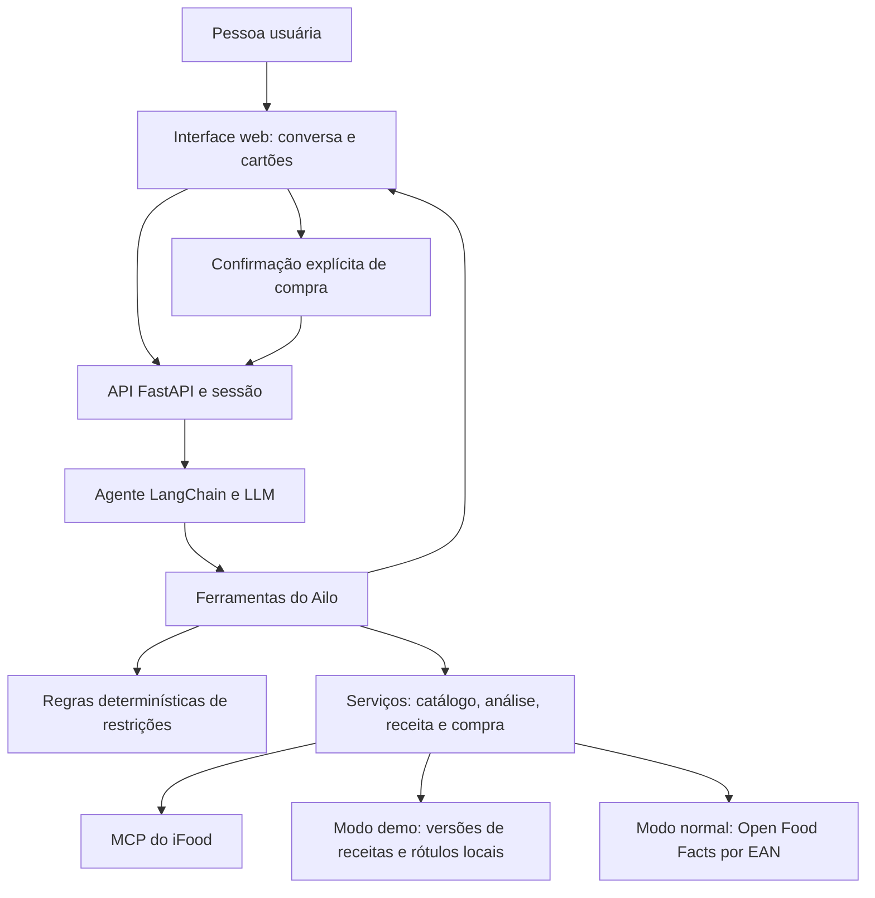

# Ailo — pedidos com atenção às restrições alimentares

**O Ailo ajuda pessoas com restrições alimentares a decidir o que pedir e a transformar uma receita adaptada em uma lista de compras no iFood.** A conversa identifica as necessidades da pessoa; ferramentas investigam produtos, explicam conflitos e procuram alternativas, mantendo a decisão de compra nas mãos do usuário.

Projeto do **Hackathon SEMCOMP × iFood 2026 — Vendendo com Agentes**. A proposta combina um agente conversacional, regras de restrição alimentar e integração com o MCP do iFood.

> Exemplo: “Quero panqueca, tenho alergia à proteína do leite.” O Ailo considera a restrição, apresenta uma versão sem leite e explica a escolha dos ingredientes. Se a pessoa acrescentar doença celíaca ou alergia a ovo, o agente pode registrar uma nova versão da lista. Produtos incompatíveis ou com avisos de risco não são escolhidos automaticamente como referências da receita.

## Guia para a banca

| Critério | Como a solução responde | Onde analisar |
| --- | --- | --- |
| **Visão & Originalidade** | Usa a conversa para acompanhar uma decisão alimentar com restrições combinadas e oferece continuidade entre restaurante e preparo em casa. | [Problema e proposta de valor](#problema-e-proposta-de-valor), [fluxos](#fluxos-da-solução). |
| **Arquitetura & Engenharia** | Separa interpretação pela LLM, regras determinísticas e operações do MCP. Mantém evidências, estado de sessão e confirmação humana do pedido. | [Arquitetura](#arquitetura-e-responsabilidades), [MCP](#integração-com-o-mcp-do-ifood), [validação](#validação). |
| **Design & Experiência** | Combina conversa curta com cartões de opções, análise, receita, comparação de mercados e revisão. Reutiliza restrições conhecidas e pergunta quando há ambiguidade. | [Decisões de experiência](#decisões-de-experiência), interface em `frontend/`. |
| **Impacto** | Busca reduzir o esforço de investigar produtos e reconstruir uma compra quando há restrições, mantendo as incertezas visíveis. | [Impacto e viabilidade](#impacto-e-viabilidade), [limitações](#limitações-do-protótipo). |
| **Comunicação & Pitch** | Um roteiro demonstra o problema, a adaptação da lista, os motivos das trocas e os produtos encontrados, distinguindo integrações reais e dados preparados. | [Cenário de demonstração](#cenário-de-demonstração). |

### Entregáveis do desafio

| Entregável | Material disponível neste repositório |
| --- | --- |
| 01 — Proposta de negócio | Problema, público, proposta de valor e hipótese de impacto neste README. |
| 02 — Desenho de solução | Fluxos e diagrama de arquitetura neste README. |
| 03 — Racional da experiência | Decisões de UX e jornada descritas abaixo. |
| 04 — Interface visual | Aplicação executável em `frontend/`, servida pelo backend. |
| 05 — Documento técnico resumido | Arquitetura, ferramentas, execução e limites neste README; [mapa de funcionalidades](docs/funcionalidades-agente.md) como material complementar. |
| 06 — Feedback sobre os MCPs | [Feedback da integração](docs/feedback-mcp.md), com dificuldades registradas durante o desenvolvimento. |

## Problema e proposta de valor

Quem possui restrições alimentares precisa responder perguntas que uma busca por nome de prato não resolve: há leite na composição? Um produto zero lactose atende à minha restrição? O substituto contém castanhas? A descrição é suficiente ou falta informação?

Quando a primeira opção não atende, a pessoa precisa repetir a investigação, escolher outro prato ou reorganizar a compra para cozinhar em casa. O Ailo conecta essas etapas na mesma conversa.

O público inclui pessoas com alergias, intolerâncias, doença celíaca, preferências vegetarianas ou veganas e restrições religiosas. O catálogo implementa **18 restrições conhecidas** e permite registrar restrições personalizadas. As regras estão documentadas em [Restrições alimentares](docs/restricoes-alimentares.md).

A proposta de valor é **ajudar a formar uma escolha e uma lista coerentes com as restrições, explicando os motivos e as informações ausentes**. O diferencial está na continuidade da decisão: investigar, reconhecer um conflito, propor uma alternativa e relacioná-la a produtos para compra.

O protótipo não certifica segurança alimentar. “Sem conflito declarado” significa que os dados considerados não indicaram conflito; não comprova ausência de alergênicos ou de contato cruzado.

## Fluxos da solução

### 1. Escolher uma refeição de restaurante

1. A pessoa informa o que deseja e suas restrições. Se disser “não posso consumir leite”, o agente deve esclarecer se é APLV ou intolerância à lactose.
2. O agente registra as restrições e busca opções próximas ao endereço da conta, usando filtros e informações disponíveis no iFood.
3. Ao escolher um item, a pessoa recebe uma análise com parecer, evidências e lacunas. O analisador considera descrição, declarações e adicionais; quando aplicável, investiga indícios no cardápio.
4. Se houver conflito ou dúvida, os caminhos incluem procurar outra opção, preparar uma mensagem para o restaurante ou seguir para o preparo em casa.
5. O agente pode montar um carrinho. A aplicação oferece revisão e, quando habilitado, envio do pedido após confirmação explícita.

A mensagem ao restaurante é preparada para envio manual. O Ailo não afirma ter contatado o estabelecimento. Uma resposta trazida pela pessoa pode ser registrada como evidência adicional.

### 2. Adaptar a receita e formar a lista de compras

1. A pessoa pede um prato para preparar em casa ou chega a esse fluxo a partir da conversa sobre restaurante.
2. No modo demo, o código seleciona uma **versão completa pré-cadastrada**, com ingredientes, quantidades, justificativas e produtos de referência.
3. A validação considera os nomes dos ingredientes e os rótulos locais disponíveis. As explicações distinguem a função culinária da troca das evidências sobre restrições.
4. A pessoa informa o que já possui em casa. Esses itens ficam fora da busca de compra.
5. O Ailo pesquisa ofertas no MCP e compara até três mercados por cobertura da lista e custo total, incluindo frete e pedido mínimo quando informados.
6. Quantidades em g/ml permitem calcular embalagens a partir do tamanho identificado no produto escolhido. Por exemplo: 600 g em pacotes de 250 g exigem três pacotes.
7. A pessoa revisa faltantes, produtos e alertas; montar o carrinho é uma continuação disponível.

O foco da demonstração é a **formação do pedido e da lista para alguém com restrições**, com a integração de compra como continuidade do fluxo.

## Decisões de experiência

- **Conversa com contexto:** prato e restrições já informados são reutilizados; o agente deve perguntar apenas o que falta esclarecer.
- **Cartões estruturados:** produtos, pareceres, ingredientes e valores são renderizados a partir das ferramentas. O texto do agente explica a escolha sem repetir o catálogo inteiro.
- **Incerteza explícita:** conflito, risco e informação insuficiente aparecem como situações diferentes, com próximos passos.
- **Trocas explicáveis:** o cartão da receita mostra a justificativa culinária e os dados disponíveis dos rótulos original e substituto.
- **Lista ajustável:** ingredientes já disponíveis em casa e preparações caseiras detalhadas em componentes ajudam a aproximar a receita da compra.
- **Perfil com consentimento:** restrições podem ser salvas localmente para reutilização, sem repetir a autorização para um perfil já salvo.
- **Controle humano da compra:** o agente organiza a compra; a confirmação do pedido ocorre na interface/API, fora das ferramentas autônomas da LLM.

A interface inclui modos Restaurante e Mercado, cartões de conversa, perfil e revisão da sacola. As páginas visuais de loja e produto também contêm um catálogo local de apresentação; sua sacola local é separada dos carrinhos criados pelo agente via MCP.

## Arquitetura e responsabilidades

Há **um agente conversacional**, com dez ferramentas. O backend usa Python, FastAPI, LangChain e `langchain-mcp-adapters`; o frontend usa HTML, CSS e JavaScript. Um único servidor entrega interface e API.

| Responsabilidade | Implementação |
| --- | --- |
| Entender intenção, esclarecer ambiguidades, escolher ferramentas e explicar resultados | LLM e [prompts](backend/ailo/agent/system_prompt.py). |
| Resolver restrições, detectar conflitos e produzir pareceres | [Catálogo](backend/ailo/restrictions/catalog.py) e [analisador](backend/ailo/restrictions/analyzer.py). |
| Selecionar versões prontas e confrontar referências de rótulos | [Serviço de receitas](backend/ailo/services/recipes.py). |
| Consultar ofertas, comparar mercados e calcular quantidades/valores | Serviços em `backend/ailo/services/`. |
| Executar operações autenticadas no iFood | [Cliente MCP](backend/ailo/ifood/client.py) e OAuth. |
| Guardar contexto da conversa | Sessão em memória: restrições, endereço, análises, receita e planos. |
| Mostrar dados estruturados | Artefatos das ferramentas e cartões em `frontend/chat-cards.js`. |

As ferramentas do MCP são encapsuladas pelos serviços do Ailo. A LLM recebe ferramentas de domínio, como `analisar_produto` e `registrar_receita`, em vez de acesso direto irrestrito às operações do iFood.

### Papel da IA e das regras

A IA continua necessária no modo demo: interpreta linguagem natural, diferencia necessidades, organiza a conversa, decide quais ferramentas chamar e explica os resultados. A seleção da receita e o parecer alimentar usam regras e dados estruturados.

Os pareceres são `CONFLITO`, `RISCO`, `INFORMACAO_INSUFICIENTE` e `SEM_CONFLITO_DECLARADO`. APLV e intolerância à lactose têm regras distintas. Declarações como “vegano” ou “sem glúten” são evidências, sem substituir informações de preparo e contato cruzado.

A criação de carrinho bloqueia conflitos conhecidos nas análises da sessão. Ela não garante que todos os produtos já tenham passado por análise completa; itens sem análise e outras pendências são tratados por alertas na revisão. O envio exige confirmação e ciência dos alertas quando aplicáveis.

## Integração com o MCP do iFood

As operações abaixo estão implementadas no projeto. A presença no código não equivale à validação integral de cada ferramenta no ambiente real.

| Etapa | Ferramentas MCP utilizadas |
| --- | --- |
| Contexto da conta e localização | `getUser`, `listAddresses` |
| Descoberta de produtos e estabelecimentos | `searchOffers`, `browseOffers` |
| Detalhes do produto | `getItem` |
| Criação e consulta de carrinho | `createCart`, `getCart` |
| Opções de entrega e pagamento | `getCartDeliveryMethods`, `listPaymentMethods` |
| Configuração e envio após confirmação | `setCartDelivery`, `setCartPayment`, `submitOrder` |
| Acompanhamento | `trackOrder` |

Os filtros alimentares ajudam a buscar candidatos. O fluxo de mercado faz buscas sem filtro e por filtro individual para ampliar a cobertura de listas com restrições combinadas. A comparação prioriza cobertura e depois custo total; produtos identificados como conflitantes são excluídos da escolha de candidatos.

O projeto lê `itemEan` quando esse campo está presente nos dados do produto. O EAN permite relacionar uma oferta ao rótulo de um produto específico. **A disponibilidade desse campo nos produtos reais ainda precisa de validação.** Nome semelhante, marca ou foto não bastam para atribuir o rótulo de outro EAN.

A LLM não recebe uma ferramenta `submitOrder`. O envio é feito por uma rota específica da aplicação após ação explícita da pessoa.

## Dados preparados e modo normal

| Componente | `DEMO_MODE=true` — padrão | `DEMO_MODE=false` |
| --- | --- | --- |
| Conversa e escolha de ferramentas | LLM | LLM |
| Receitas | 15 pratos com versões completas cadastradas; sem combinação de trocas durante o chat | Receita proposta pelo agente e validada por regras |
| Rótulos | 16 produtos reais pré-carregados, com fontes e data de conferência | Consulta à Open Food Facts pelo EAN |
| Ofertas, disponibilidade, preços e carrinhos do agente | MCP real do iFood | MCP real do iFood |
| Confirmação de pedido | Ação explícita na interface/API, se o envio estiver habilitado | Mesmo comportamento |

`DEMO_MODE` controla receitas e rótulos; **não é um modo offline do iFood nem impede compras reais**. O envio tem configuração independente: `ALLOW_SUBMIT_ORDER`.

Os arquivos [demo_recipes.json](backend/ailo/data/demo_recipes.json) e [demo_labels.json](backend/ailo/data/demo_labels.json) tornam a demonstração reproduzível. Os rótulos incluem EAN, marca, embalagem, composição publicada, avisos, fontes e data de conferência. Alguns registros resumem a composição e informam isso em `sourceNote`.

Campos vazios não certificam ausência de alergênicos. O catálogo não comprova estoque no iFood e não possui cobertura de todo o mercado. No modo demo, um EAN desconhecido fica sem rótulo local, sem consulta externa automática.

Ao selecionar uma versão, referências com conflito ou risco não são escolhidas automaticamente. Quando não existe versão compatível, o sistema recusa o pedido de receita em vez de inventar ingredientes. Informações incompletas permanecem identificadas como tal.

Leia os [produtos, fontes e cenários de demonstração](docs/demo-catalogo.md).

## Cenário de demonstração

A jornada apresentada parte de uma necessidade concreta e acompanha a formação
da lista conforme novas informações aparecem:

1. **Pedido inicial:** “Quero preparar panqueca. Tenho alergia à proteína do leite.”
2. **Adaptação explicada:** apresentação da versão sem leite, com a justificativa e os dados dos produtos de referência.
3. **Restrições combinadas:** ao acrescentar doença celíaca e alergia a ovo, seleção de uma versão completa compatível.
4. **Lista personalizada:** exclusão de azeite e sal quando a pessoa informa que já os possui.
5. **Busca no iFood:** apresentação dos produtos encontrados, cobertura dos ingredientes, valores e faltantes por mercado.
6. **Reconhecimento de limites:** se houver também alergia a soja, o aviso da farinha de referência impede a seleção automática daquela versão.
7. **Continuidade da compra:** escolha do mercado e revisão dos itens do carrinho, com confirmação humana para o envio do pedido.

O diferencial está na formação da escolha e da lista. A criação do carrinho é a
continuidade dessa jornada; ela não equivale ao envio de um pedido.

## Impacto e viabilidade

A hipótese é que uma conversa contextual, com justificativas e lista de compra, reduza o esforço de procurar alternativas e diminua escolhas contraditórias com as restrições informadas. Para o ecossistema iFood, o fluxo também oferece continuidade quando a primeira opção não atende: outro produto ou uma compra de ingredientes.

O protótipo comprova a estrutura técnica da proposta, mas **não há métricas de conversão, redução de tempo ou eficácia clínica medidas**. Uma avaliação posterior pode medir tempo para formar uma lista, cobertura dos ingredientes, quantidade de conflitos detectados, compreensão dos alertas e conclusão da compra.

A evolução inclui ampliar a curadoria de receitas e rótulos, validar os retornos reais do MCP, oferecer isolamento de perfis por usuário e conduzir testes de experiência com o público-alvo. Essas etapas são propostas futuras, não funcionalidades entregues.

## Validação

Foram validados **92 testes automatizados**, cobrindo restrições, rótulos,
seleção de receitas completas, quantidades de embalagens e itens já disponíveis
em casa. A verificação de sintaxe do frontend também passou.

A suíte específica do agente não está incluída nesse total: suas execuções
anteriores não concluíram. Os testes usam serviços simulados e não equivalem
à homologação de pedidos reais no iFood.

## Limitações do protótipo

- A análise depende das informações publicadas e das evidências disponíveis. Dados ausentes de composição, preparo e fabricação não são preenchidos pela IA.
- A disponibilidade de EAN no retorno do MCP e a correspondência dos produtos precisam de conferência prática. Um código interno de loja não deve ser presumido como EAN de fabricante.
- As receitas demo cobrem cenários preparados; nem todo prato possui uma versão para toda combinação de restrições. Elas não foram submetidas a validação culinária ou clínica formal.
- A busca tem limites de resultados e páginas; não representa uma auditoria integral do cardápio nem do ambiente de preparo.
- Quantidades sem tamanho de embalagem identificável permanecem estimativas iniciais para revisão. A reanálise detalhada da comparação de mercados se concentra no mercado recomendado.
- Conversas ficam em memória e são perdidas ao reiniciar. O perfil local é por instalação; não há isolamento de contas de múltiplos usuários para uso em produção.
- As integrações de carrinho, checkout e envio possuem código implementado, mas sua validação completa no ambiente real não está concluída. Criar um carrinho não envia o pedido nem efetua pagamento.
- O catálogo visual local das páginas de loja/produto não deve ser apresentado como resultado obtido do MCP.

## Feedback sobre o MCP

O [feedback da integração](docs/feedback-mcp.md) registra dificuldades percebidas
em informações alimentares, filtros, autenticação e formatos das ferramentas.
São observações do desenvolvimento, sem pressupor que descrevam todos os
produtos ou versões do serviço.

A principal oportunidade de evolução identificada é disponibilizar composição,
alergênicos, avisos de contato cruzado e classificações alimentares de forma
estruturada e com origem explícita. Isso permitiria ao agente fundamentar mais
decisões nos dados do próprio iFood.
