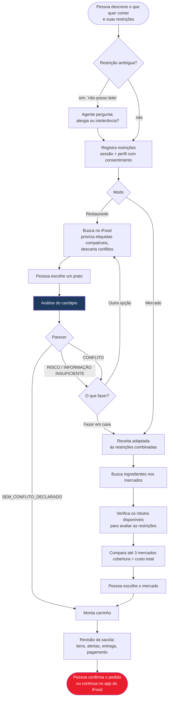
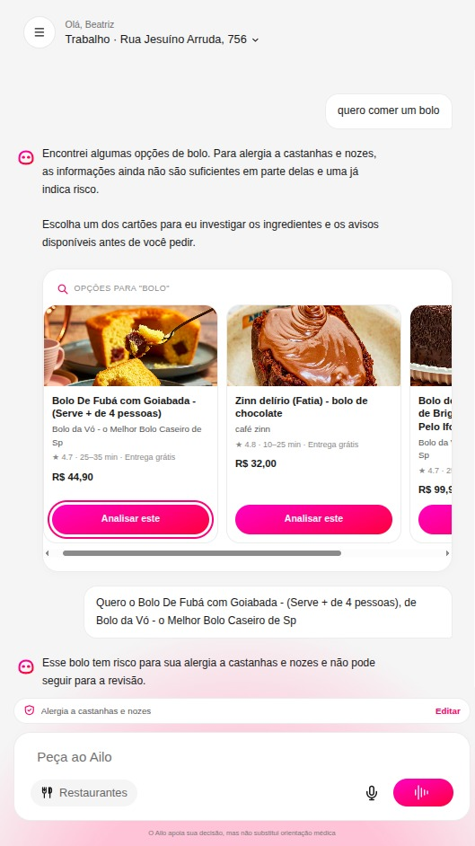
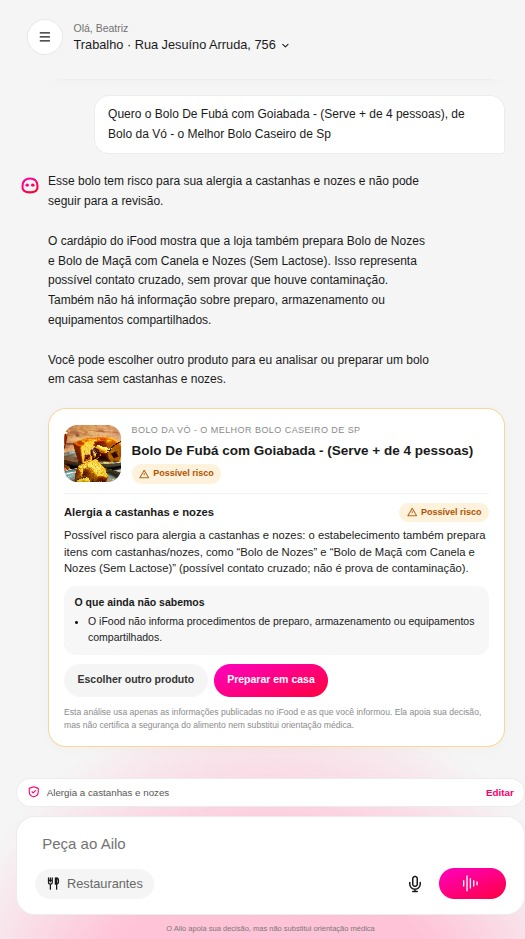
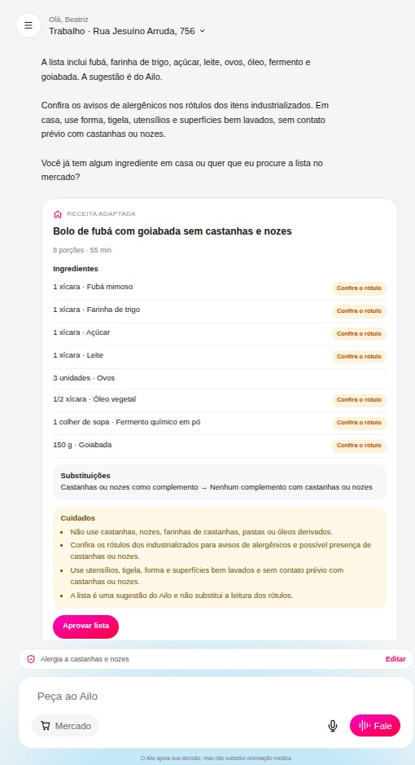
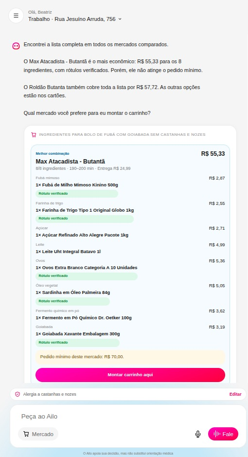
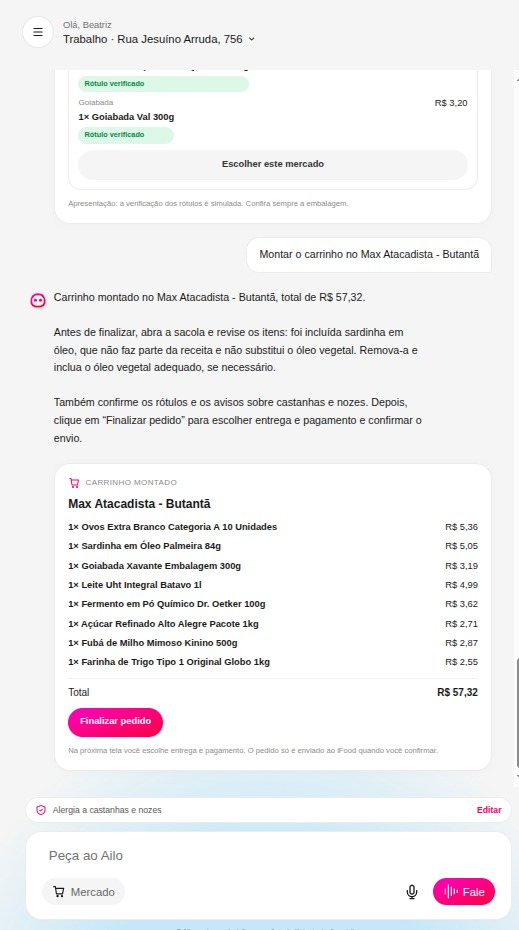
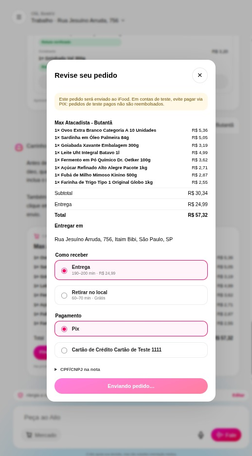
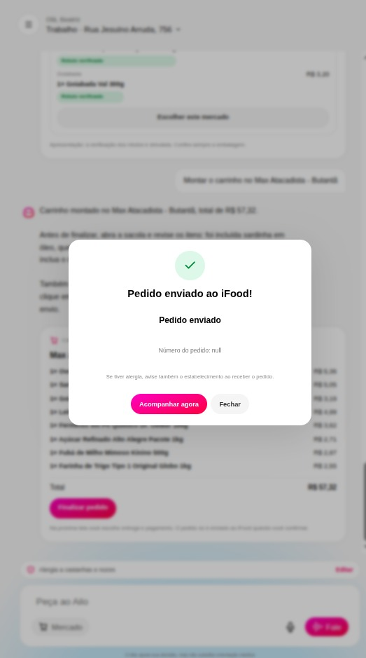
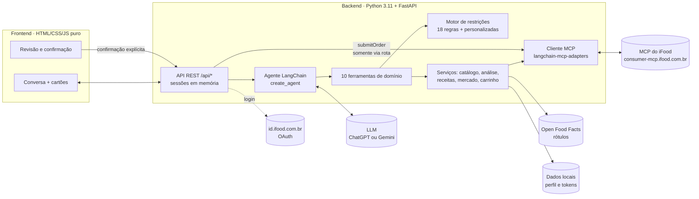
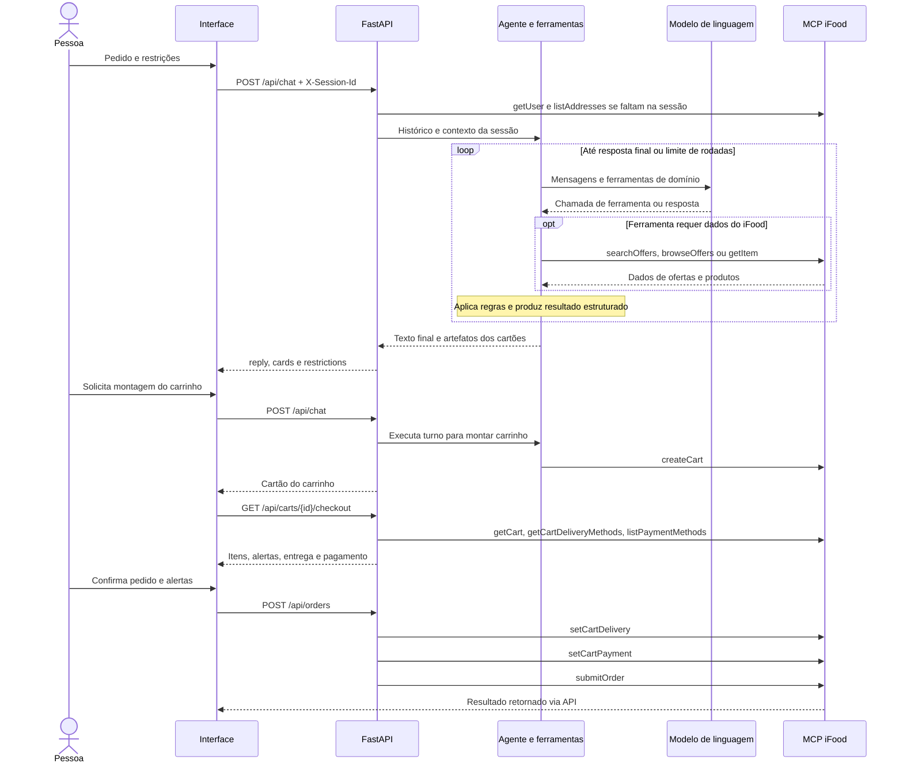

# Ailo — o agente do iFood para quem tem restrição alimentar

> **"Quero uma lasanha, mas tenho alergia à proteína do leite e sou celíaca."**
> Hoje essa pessoa abre dez cardápios, lê descrições incompletas e desiste. Com o Ailo, ela diz isso uma vez. O agente procura opções compatíveis perto dela, investiga cada prato, explica o que sabe e o que *não* sabe. Se nada servir, transforma o pedido numa receita adaptada com a lista de compras pronta no mercado do iFood.

Projeto do **Hackathon SEMCOMP × iFood 2026: Vendendo com Agentes**.

| | |
| --- | --- |
| **Para quem** | Pessoas com alergias, intolerâncias, doença celíaca, restrições religiosas ou dieta vegetariana/vegana. 18 restrições já vêm cadastradas, e o usuário pode criar outras. |
| **O que o agente faz** | Conversa, registra as restrições, busca no iFood, analisa cada produto com regras determinísticas, adapta receitas, compara mercados e monta o carrinho. |
| **O que é real** | Conta, endereço, busca, cardápios, preços, carrinhos e checkout vêm do **MCP oficial do iFood**, com o OAuth do agente. |
| **O que vem de fora** | Rótulos de industrializados vêm da Open Food Facts (pelo código de barras ou pelo nome e marca). As receitas adaptadas são propostas pela IA e validadas pelas regras. |
| **Princípio central** | A IA conversa e decide *quais ferramentas usar*. O parecer alimentar sai de regras auditáveis, e **quem confirma o pedido é sempre a pessoa**. |

---

## Sumário: onde encontrar cada entregável

| # | Entregável | Seção |
| --- | --- | --- |
| 01 | Proposta de Negócio | [Problema, público e proposta de valor](#01--proposta-de-negócio) |
| 02 | Desenho de Solução | [Fluxo geral e responsabilidades](#02--desenho-de-solução) |
| 03 | Racional da Experiência | [Decisões de UX e por quê](#03--racional-da-experiência) |
| 04 | Interface Visual | [Telas e como ver funcionando](#04--interface-visual) |
| 05 | Documento Técnico Resumido | [Arquitetura, MCP, execução e testes](#05--documento-técnico-resumido) |
| 06 | Feedback sobre os MCPs | [Dificuldades reais e sugestões](#06--feedback-sobre-os-mcps) |

Os seis itens seguem os entregáveis obrigatórios do material do Hackathon SEMCOMP × iFood fornecido à equipe. A documentação distingue comportamento implementado, simulação de apresentação e validação automatizada; não pressupõe homologação de pedidos reais.

### Leitura pelos critérios da banca

| Critério | Evidência nesta entrega |
| --- | --- |
| Visão e originalidade | Continuidade entre prato pronto, investigação e compra de ingredientes na proposta de negócio |
| Arquitetura e engenharia | Diagramas, ferramentas de domínio, integração MCP, regras, API e testes na seção técnica |
| Design e experiência | Racional de UX, interface executável e cartões com próximos passos |
| Impacto | Problema e público definidos; indicadores de piloto propostos, sem alegar resultados de uso não medidos |
| Comunicação e pitch | Roteiro de demonstração com origem dos dados e limites explícitos |

Atalhos: [como rodar](#como-rodar) · [roteiro de demonstração](#roteiro-de-demonstração) · [limitações](#limitações-conhecidas)

---

## 01 · Proposta de Negócio

### O problema

Para quem tem restrição alimentar, pedir comida exige investigar, e o app não ajuda nessa investigação:

- **A busca não responde à pergunta certa.** "Tem lasanha perto de mim?" é fácil. "Essa lasanha tem leite? O molho leva farinha de trigo? Fritam na mesma panela?" a busca não responde.
- **A informação existe pela metade.** Descrições curtas, sem lista de ingredientes nem aviso de "pode conter".
- **As restrições se combinam.** Quem é celíaco *e* tem APLV não consegue usar dois filtros ao mesmo tempo sem perder opções válidas (detalhe no [feedback do MCP](#06--feedback-sobre-os-mcps), item 4).
- **Rótulos confundem.** "Zero lactose" parece servir para quem tem alergia ao leite, e não serve.
- **Quando nada serve, o pedido se perde.** A pessoa fecha o app e vai improvisar algo em casa, sem ajuda.

### O tamanho do problema

Os grupos abaixo se sobrepõem, por isso não somamos os números. Mesmo isolado, cada um é grande.

| Público | Dado | Fonte |
| --- | --- | --- |
| Desconforto com lácteos | **53 milhões de brasileiros** (35% da população acima de 16 anos) relatam sintomas ao consumir lácteos; 59% são mulheres | [REBES/GVAA](https://www.gvaa.com.br/revista/index.php/REBES/article/download/12210/14445/63893) |
| Intolerância à lactose | **Mais da metade dos brasileiros** tem genes associados à intolerância à lactose | [Jornal da USP](https://jornal.usp.br/radio-usp/mais-da-metade-dos-brasileiros-possuem-genes-que-podem-causar-a-intolerancia-a-lactose/), [PMC2761420](https://pmc.ncbi.nlm.nih.gov/articles/PMC2761420/) |
| Alergia alimentar | Reações alérgicas a alimentos acometem **até 8% da população** | [ASBAI](https://asbai.org.br/bares-e-restaurantes-ganharao-guia-pratico-para-lidar-com-alergia-alimentar/) |
| Doença celíaca | Cerca de **1,4% da população mundial** | [Singh et al., 2018 (PubMed)](https://pubmed.ncbi.nlm.nih.gov/29551598/) |
| Alergia a ovo | **0,2% dos adultos** | [IFSC Verifica](https://www.ifsc.edu.br/web/ifsc-verifica/w/alergias-e-intolerancias-alimentares-saiba-o-que-sao) |
| Vegetarianos | **14% da população brasileira** | [SVB](https://svb.org.br/mercado-vegetariano/) |
| Veganos | **7% da população brasileira** | [Pesquisa de mercado](https://drive.google.com/file/d/1STJ9zEY3M-8nl8GaCZVsrkMtUlxavSJz/view) |

### Comer fora é onde o risco acontece

- **7 em cada 10 reações alérgicas graves** ocorrem quando a pessoa come fora de casa ([ASBAI](https://asbai.org.br/bares-e-restaurantes-ganharao-guia-pratico-para-lidar-com-alergia-alimentar/)). A própria associação recomenda ligar para o restaurante antes de pedir e confirmar ingredientes e preparo ([ASBAI: comer fora com alergia alimentar](https://asbai.org.br/comer-fora-com-alergia-alimentar-um-desafio-real/)), justamente a investigação que o Ailo automatiza.
- Numa pesquisa da Food Standards Agency (Reino Unido) com jovens com alergia ou intolerância, **60% evitaram comer fora** nos seis meses anteriores por causa da condição, **39% sempre pedem só pratos que já sabem ser seguros** e **59% costumam voltar aos mesmos lugares** ([FSA](https://webarchive.nationalarchives.gov.uk/ukgwa/20201201121206/https://www.food.gov.uk/research/food-allergy-and-intolerance-research/young-people-and-food-allergies-and-intolerances)).
- Pessoas com alergia alimentar têm mais ansiedade e limitações nas atividades ligadas à alimentação, principalmente pelo medo de exposição acidental ([PMC4146781](https://pmc.ncbi.nlm.nih.gov/articles/PMC4146781/); relato em [Allergic Living](https://www.allergicliving.com/2010/07/02/food-allergy-fear-of-food/)).

**O que isso significa para o iFood:** a falta de informação confiável sobre ingredientes e contato cruzado é uma barreira de compra. Esse público pede menos, explora menos lojas e repete os mesmos pratos. Dar segurança para a decisão é uma forma de recuperar e ampliar essas vendas.

**Próximo público:** a hipertensão atinge **29,7% dos adultos brasileiros** ([Vigitel 2025, via APM](https://www.apm.org.br/hipertensao-atinge-quase-um-terco-da-populacao-adulta-brasileira/)), cerca de 36 milhões de pessoas ([UFPel](https://ccs2.ufpel.edu.br/wp/2022/05/17/hipertensao-arterial-doenca-silenciosa/)). A restrição de sódio ainda não está no catálogo do Ailo, mas o motor de regras permite adicioná-la.

### A proposta de valor

> **O Ailo transforma "não sei se posso comer isso" em uma decisão informada: um prato compatível ou uma lista de compras adaptada. Tudo na mesma conversa.**

O diferencial é a **continuidade da decisão**. Concorrentes, e o próprio app hoje, param no filtro. O Ailo segue o caminho inteiro:

```
pedido → busca compatível → análise do cardápio → prato compatível? carrinho
                                              → dúvida ou conflito? outra opção
                                              → preparar em casa? receita adaptada → ingredientes e rótulos → mercado → carrinho
```

### Valor para cada lado

| Para quem pede | Para o iFood | Para restaurantes e mercados |
| --- | --- | --- |
| Menos tempo investigando cardápios | **Recupera pedidos que seriam abandonados**, levando a pessoa do restaurante para o mercado | Clientes encontram opções com informações alimentares mais claras |
| Explicação clara do motivo de cada parecer | Fidelização de um público que hoje confia pouco em apps de delivery | Demanda visível por informação alimentar estruturada |
| Restrições lembradas entre conversas (com consentimento) | Cesta maior no mercado: uma receita inteira em um carrinho | Mais vendas de produtos "sem" (sem glúten, vegano etc.) |

### Por que um agente (e não um filtro melhor)

Restrição alimentar é uma conversa, não uma checkbox. "Não posso comer leite" pode ser APLV ou intolerância à lactose, e cada caso leva a um parecer diferente. "Sou muçulmano" precisa ser confirmado como halal. Quando a primeira opção falha, o próximo passo depende do contexto. Um agente consegue perguntar o que falta, lembrar o que já foi dito e encadear as operações do MCP (buscar, detalhar, comparar, montar carrinho) sem que a pessoa navegue por dez telas.

### Como mediríamos o impacto

O protótipo valida a estrutura técnica, **mas não temos métricas de uso real**. Num piloto, acompanharíamos:

- taxa de conversão de buscas com restrição (com e sem o Ailo);
- pedidos "recuperados", em que a pessoa não achou prato pronto e comprou ingredientes;
- tempo até a primeira decisão;
- quantidade de conflitos que o agente evitou;
- compreensão dos alertas, medida em testes de usabilidade com o público-alvo.

---

## 02 · Desenho de Solução

### Fluxo geral



### Estado da implementação

| Capacidade | Implementação e evidência | Limite atual |
| --- | --- | --- |
| Conversa com ferramentas | `create_agent`, 10 ferramentas e cartões estruturados em [`agent/`](backend/ailo/agent/) | Depende de acesso ao provedor de LLM |
| Busca e análise de restaurantes | [`catalog.py`](backend/ailo/agent/tools/catalog.py), [`analysis.py`](backend/ailo/services/analysis.py) e motor de restrições | Parecer depende dos dados publicados; não certifica ausência de alergênicos |
| Receita adaptada | LLM propõe; regras validam cada ingrediente | Sem validação culinária formal |
| Comparação de mercados | Busca paralela, até 3 mercados, cobertura e total com frete | Aprofundamento de descrição e rótulos somente no recomendado |
| Carrinho, checkout e acompanhamento | [`cart.py`](backend/ailo/services/cart.py) e rotas próprias | Implementados; homologação completa no iFood real pendente |
| Perfil alimentar | Persistência local com consentimento e exclusão | Perfil e credenciais compartilhados pela instalação |

### Os dois fluxos em uma frase

1. **Restaurante:** encontra pratos compatíveis perto da pessoa, mostra só o que não conflita com as restrições, analisa o prato escolhido e, se houver dúvida, oferece escolher outro prato ou preparar em casa.
2. **Mercado (preparo em casa):** adapta a receita a *todas* as restrições ao mesmo tempo (por exemplo, panqueca sem leite, sem glúten e sem ovo), busca ingredientes, verifica os rótulos disponíveis para avaliar as restrições, calcula quantas embalagens comprar quando há dados suficientes e compara mercados por cobertura da lista e custo total com frete.

### Quem faz o quê

A decisão de arquitetura mais importante é **não deixar a LLM decidir se um alimento é compatível**.

| Responsabilidade | Quem executa | Por quê |
| --- | --- | --- |
| Entender o pedido, perguntar o que falta, escolher ferramentas, explicar o resultado | **LLM** (agente LangChain) | É o que a IA faz bem: linguagem natural e orquestração |
| Decidir se há conflito com a restrição | **Regras determinísticas** ([analisador](backend/ailo/restrictions/analyzer.py) + [catálogo de 18 restrições](docs/restricoes-alimentares.md)) | Precisa ser auditável e reproduzível; a LLM não pode "suavizar" um risco |
| Buscar, detalhar, montar carrinho | **MCP do iFood**, chamado pelos serviços do Ailo | Dados reais da conta, do endereço e das lojas |
| Confirmar e enviar o pedido | **A pessoa**, na tela de revisão | A LLM não tem acesso à ferramenta `submitOrder` |

O agente nunca chama o MCP diretamente. Ele recebe **10 ferramentas de domínio** (`analisar_produto`, `registrar_receita`, `montar_carrinho`…) que encapsulam o MCP e aplicam as travas de segurança. Detalhes na [seção técnica](#ferramentas-do-agente).

---

## 03 · Racional da Experiência

Cada decisão abaixo responde a uma dor concreta do público.

| Decisão | Por quê |
| --- | --- |
| **Uma conversa, não um formulário.** A pessoa escreve (ou dita, com o microfone) do jeito que falaria com um amigo. | Restrições são pessoais e cheias de nuance. Um formulário de 18 checkboxes não captura "sou celíaca e meu filho tem alergia a amendoim". |
| **O agente pergunta só o que muda o resultado.** "Não posso leite" vira: *é alergia à proteína ou intolerância à lactose?* | A resposta muda o parecer: zero lactose serve para um caso e é perigoso para o outro. Perguntas desnecessárias cansam. |
| **Cartões estruturados no lugar de paredes de texto.** Opções, parecer, receita, comparação de mercados e carrinho aparecem como cartões gerados pelos dados, não pelo texto da IA. | Preço, ingrediente e parecer não podem ser "alucinados". O texto do agente só comenta o que o cartão mostra. |
| **Quatro pareceres, não "seguro/inseguro".** `CONFLITO`, `RISCO`, `INFORMAÇÃO INSUFICIENTE`, `SEM CONFLITO DECLARADO`. | Honestidade gera confiança. "Não encontramos conflito nos dados" é diferente de "é seguro", e o público com alergia sabe disso. |
| **Toda dúvida tem uma saída.** O parecer sempre vem com próximos passos: ver outra opção ou fazer em casa. | Um "não pode" sem alternativa vira pedido abandonado. |
| **Trocas explicadas.** Na receita adaptada, cada substituição apresenta o motivo proposto pela IA. O rótulo da oferta é consultado depois, na análise do produto. | A pessoa entende e confia na adaptação, e aprende a repetir sozinha. |
| **Restrições lembradas, com consentimento.** O perfil é salvo localmente só após autorização e não é pedido de novo. | Repetir "sou celíaca" a cada pedido é cansativo, mas dado de saúde exige consentimento explícito. |
| **A pessoa tem a palavra final.** O agente monta o carrinho; a revisão mostra itens, alertas, entrega e pagamento, e só um clique dela envia o pedido. | Compra é uma ação com consequências, e alergia é uma questão de saúde. O controle não pode ficar com a IA. |
| **Aviso permanente:** "O Ailo apoia sua decisão, mas não substitui orientação médica". | Expectativa correta sobre o que um agente pode garantir. |

---

## 04 · Interface Visual

A interface é uma aplicação web executável, no estilo visual do iFood, servida pelo próprio backend. Depois de [rodar o projeto](#como-rodar), abra `http://localhost:5173`.

### A jornada completa em telas

Capturas de uma conversa real com o MCP do iFood: uma pessoa com alergia a castanhas e nozes quer um bolo. O prato do restaurante apresenta risco de contato cruzado, ela decide preparar em casa e o Ailo leva a receita até o pedido no mercado.

<table>
  <tr>
    <td align="center" width="25%"><br/><b>1. Opções</b><br/><sub>Pratos reais perto do endereço, prontos para análise</sub></td>
    <td align="center" width="25%"><br/><b>2. Análise</b><br/><sub>Possível risco: a loja também prepara bolos com nozes. Saídas: outro produto ou preparar em casa</sub></td>
    <td align="center" width="25%"><br/><b>3. Receita adaptada</b><br/><sub>Ingredientes, trocas, cuidados e itens que pedem conferir o rótulo</sub></td>
    <td align="center" width="25%"><br/><b>4. Comparação de mercados</b><br/><sub>Cobertura da lista, preço por item, frete e pedido mínimo</sub></td>
  </tr>
  <tr>
    <td align="center"><br/><b>5. Carrinho</b><br/><sub>Criado no iFood; o agente aponta um item que merece revisão</sub></td>
    <td align="center"><br/><b>6. Revisão</b><br/><sub>Itens, entrega, pagamento e aviso antes do envio</sub></td>
    <td align="center"><br/><b>7. Pedido enviado</b><br/><sub>Só depois da confirmação da pessoa, com lembrete de avisar a alergia</sub></td>
    <td></td>
  </tr>
</table>

> Na tela 4, o selo "Rótulo verificado" vem da opção de apresentação `SIMULATE_LABEL_CHECK`, e o próprio cartão avisa que a verificação é simulada (ver [opções para testes e apresentação](#opções-para-testes-e-apresentação)).

| Tela | Arquivo | O que mostra |
| --- | --- | --- |
| **Conversa com o Ailo** | [`index.html`](frontend/index.html) | Tela inicial com sugestões de pedido, alternância **Restaurantes / Mercado**, entrada por texto ou voz e cartões interativos na conversa |
| **Revisão do pedido** | diálogo em `index.html` + [`checkout.js`](frontend/checkout.js) | Itens, quantidades, alertas, endereço, entrega, pagamento, confirmação explícita e link para abrir o carrinho no app do iFood |
| **Perfil alimentar** | [`perfil.html`](frontend/perfil.html) | Restrições salvas, consentimento e exclusão do perfil |

**Cartões que o agente renderiza na conversa** ([`chat-cards.js`](frontend/chat-cards.js)):

| Cartão | Conteúdo |
| --- | --- |
| Restrições | O que foi entendido, com opção de salvar no perfil |
| Opções | Até 3 pratos compatíveis, com preço e indicação de etiqueta do iFood |
| Restaurantes | Lojas encontradas para o pedido |
| Análise | Parecer por restrição, evidências com origem, informações ausentes e botões de próximo passo |
| Receita adaptada | Ingredientes, quantidades, trocas justificadas e produtos de referência |
| Comparação de mercados | Mercado recomendado, cobertura da lista, faltantes, frete e total |
| Carrinho | Itens, valores, alertas e acesso à revisão |

---

## 05 · Documento Técnico Resumido

### Arquitetura



Um único servidor entrega a interface e a API. Cada mensagem do usuário vira um turno do agente: a LLM recebe o histórico e o contexto da sessão (modo, restrições ativas, endereço) e chama as ferramentas necessárias, com limite de 10 rodadas por mensagem. As ferramentas devolvem **dois** resultados: um JSON compacto para a LLM e um **cartão** (`content_and_artifact` do LangChain) que vai direto para a interface, sem passar pelo texto do modelo.

### Sequência de uma conversa e do pedido



A sequência de ferramentas é escolhida pela LLM conforme o pedido; não há uma chamada fixa por mensagem.

### Origem e transformação dos dados

| Dado mostrado | Origem | Tratamento no Ailo |
| --- | --- | --- |
| Nome e endereços | MCP: `getUser`, `listAddresses` | Prioriza último endereço usado, depois mais usado em 30 dias, depois primeiro; coordenadas orientam a busca |
| Restrições | Usuário na conversa ou perfil local autorizado | Resolve catálogo de 18 restrições ou termos personalizados; guarda na sessão |
| Produtos, preços, imagens e lojas | MCP: `searchOffers`, `browseOffers`, `getItem` | Normaliza respostas, remove conflitos e limita opções exibidas |
| Etiquetas alimentares | Resultados de consultas com `itemRestrictions` | Guarda a associação item/etiqueta na sessão; não inventa etiquetas ausentes |
| Ingredientes e trocas da receita | LLM via `registrar_receita` | Regras recusam conflito; aceitação ainda pode exigir conferência de rótulo |
| Ingredientes, alergênicos e avisos do produto | Open Food Facts | Consulta EAN; sem EAN válido, busca nome e marca, depois consulta o EAN encontrado |
| Parecer alimentar | [`analyzer.py`](backend/ailo/restrictions/analyzer.py) | Quatro pareceres com evidências; a opção de simulação de mercado altera resultados insuficientes, conforme descrito abaixo |
| Embalagens e comparação de mercados | Receita + tamanho publicado na oferta + preços do MCP | Calcula embalagens quando há quantidade estruturada compatível; soma itens e frete |
| Entrega, pagamento e resultado do pedido | MCP do iFood | Normaliza para a revisão e exige confirmação na rota de envio |

A busca de rótulo por nome exige que as palavras do produto encontrado e uma marca constem no anúncio. Isso é uma heurística: pode não distinguir versões e embalagens. Com EAN válido não encontrado na base, o código retorna ausência de rótulo, sem tentar a busca textual. As consultas usam timeout de 8 segundos e caches em memória de 6 horas; falhas temporárias não viram evidência de compatibilidade.

### Algoritmo de comparação de mercados

1. Para cada ingrediente, busca até 10 resultados por consulta: uma sem etiqueta e uma por etiqueta aplicável, em paralelo. Se não houver produto relevante, tenta a palavra principal do termo.
2. Deduplica, filtra relevância por nome e descarta conflitos. Por ingrediente e loja, prioriza parecer mais favorável e depois preço.
3. Ordena mercados por maior cobertura e depois menor total com frete; seleciona até 3 e busca os ingredientes faltantes nessas lojas.
4. No recomendado, consulta descrições e rótulos, recalcula embalagens e remove conflitos identificados. Recalcula seus totais, sem uma nova ordenação global após essa etapa.
5. Retorna recomendado, alternativas, faltantes e indicação de pedido mínimo. Não divide a compra automaticamente entre lojas.

### Stack

| Camada | Tecnologia |
| --- | --- |
| Agente | LangChain 1.x (`create_agent`), `langchain-mcp-adapters` |
| LLM | ChatGPT via OAuth da assinatura (padrão) **ou** Gemini via API key, alternáveis por `LLM_PROVIDER` |
| Backend | Python ≥ 3.11, FastAPI, Uvicorn, httpx, gerenciado com `uv` |
| Frontend | HTML, CSS e JavaScript sem framework e sem etapa de build |
| Integração | MCP do iFood (`consumer-mcp.ifood.com.br/marketplace`) com OAuth 2.0 |
| Testes | pytest + pytest-asyncio, com MCP e LLM simulados ([`tests/fakes.py`](backend/tests/fakes.py)) |

### Ferramentas do agente

As principais ferramentas do fluxo apresentado estão listadas abaixo. O registro completo no código contém 10 ferramentas. Elas estão registradas em [`agent/tools/__init__.py`](backend/ailo/agent/tools/__init__.py) e os prompts centralizados em [`agent/system_prompt.py`](backend/ailo/agent/system_prompt.py).

| Ferramenta | O que faz | MCP por trás |
| --- | --- | --- |
| `registrar_restricoes` | Resolve e guarda as restrições (catálogo ou personalizadas); invalida análises antigas se mudarem | — |
| `buscar_opcoes` | Busca pratos ou lojas; prioriza etiquetas do iFood, confere a descrição dos demais e descarta conflitos; sugere alternativas quando o pedido não tem opção compatível | `searchOffers`, `browseOffers`, `getItem` |
| `ver_cardapio_da_loja` | Lista itens de uma loja específica | `searchOffers` |
| `analisar_produto` | Parecer determinístico: descrição, declarações "sem", contradições, adicionais e cardápio (possível contato cruzado) | `getItem`, `browseOffers` |
| `registrar_receita` | Valida a receita adaptada contra as restrições; recusa se houver conflito | — |
| `buscar_ingredientes_no_mercado` | Busca cada ingrediente com e sem filtros, compara até 3 mercados e calcula embalagens | `searchOffers`, `getItem` |
| `montar_carrinho` | Cria carrinho de restaurante e **bloqueia itens com `CONFLITO`** | `createCart` |
| `montar_carrinho_do_mercado` | Cria o carrinho com o plano do mercado escolhido | `createCart` |

Fora do alcance da LLM, acionadas só pela interface: `getUser`, `listAddresses`, `getCart`, `getCartDeliveryMethods`, `listPaymentMethods`, `setCartDelivery`, `setCartPayment`, **`submitOrder`** e `trackOrder`.

### Decisões técnicas principais

1. **Regras determinísticas para o parecer.** O [catálogo de restrições](backend/ailo/restrictions/catalog.py) define, para cada uma, termos de conflito, termos de atenção, expressões ignoradas ("leite de coco" não é leite animal), declarações aceitas e declarações insuficientes ("zero lactose" não atende APLV). O [analisador](backend/ailo/restrictions/analyzer.py) normaliza acentos, trata negações e devolve evidências com origem. O documento [restrições alimentares](docs/restricoes-alimentares.md) é gerado a partir do código.
2. **`submitOrder` fora do alcance da IA.** O envio passa por `POST /api/orders`, que exige confirmação explícita, ciência dos alertas e `ALLOW_SUBMIT_ORDER` habilitado.
3. **Contornando o E lógico dos filtros do MCP no mercado.** Na busca de ingredientes com várias restrições, o Ailo faz uma busca por filtro e mais uma sem filtro, e une os resultados, para não esconder produtos válidos.
4. **Cartões estruturados na interface.** Os cartões recebem os resultados das ferramentas como artefatos, preservando os dados de produtos e os pareceres calculados pelo backend.
5. **Quantidade de embalagens calculada quando há dados estruturados.** O cálculo usa `quantidadeNecessaria` em g/ml e o tamanho publicado na oferta, arredondando para cima (600 g em pacotes de 250 g = 3 pacotes). Sem quantidade estruturada ou unidades compatíveis, mantém `quantidadeCompra`. O esquema atual da ferramenta de receita não exige nem expõe `quantidadeNecessaria`, portanto esse cálculo não é garantido em toda receita gerada.
6. **Identificação do rótulo e seus limites.** O rótulo é buscado pelo EAN; sem ele (o MCP ainda não expõe o código de barras, embora ele exista no cadastro do iFood), pelo nome, exigindo que a marca também apareça no anúncio. O resultado por nome recebe `matchedBy=name` e um aviso para conferir a embalagem; essa associação não confirma a identidade pelo código de barras.
7. **Provedor de LLM trocável.** Só [`chat_model.py`](backend/ailo/agent/chat_model.py) conhece o provedor; o resto usa a interface padrão do LangChain.

### API HTTP e estado

A interface usa JSON e o cabeçalho `X-Session-Id`, criado por aba em `sessionStorage`. O contrato pode ser inspecionado no Swagger em `http://localhost:5173/docs` e no OpenAPI em `/openapi.json`.

| Método e rota | Responsabilidade |
| --- | --- |
| `GET /api/status` | Estado de credenciais, LLM e habilitação de envio |
| `POST /api/auth/ifood/login`, `/logout` | Iniciar OAuth ou desconectar |
| `GET /api/session`, `/api/addresses` | Contexto atual e endereços |
| `POST /api/session/address`, `/mode`, `/reset` | Trocar endereço, fluxo ou reiniciar conversa |
| `POST /api/chat` | Processar mensagem; devolve `reply`, `cards` e `restrictions` |
| `GET /api/restrictions/catalog` | Catálogo de restrições |
| `GET`, `PUT`, `DELETE /api/profile` | Consultar, salvar com consentimento e excluir perfil |
| `GET /api/carts/{cart_id}` | Consultar carrinho da sessão |
| `GET /api/carts/{cart_id}/checkout` | Dados de revisão, entrega e pagamento |
| `POST /api/orders` | Confirmar e enviar pedido |
| `GET /api/orders/{order_id}/track` | Acompanhar pedido criado na sessão |

As sessões expiram após 6 horas sem uso e o histórico é limitado a 60 mensagens, preservando pares de ferramenta e resultado. Reiniciar o processo perde as conversas. Perfil e tokens são persistidos em `DATA_DIR`, com gravação restrita a `0600`; o identificador de sessão não substitui autenticação de usuários.

### Autenticação e tratamento de falhas

- OAuth do iFood com PKCE, validação de `state`, renovação de token com controle de concorrência e revogação ao desconectar. O MCP usa transporte `streamable_http` com Bearer token e ferramentas descobertas sob demanda.
- Schemas de ferramentas de domínio controlados pelo projeto, sem expor diretamente à LLM todos os schemas do MCP.
- Erros de ferramenta retornam como resultado para a LLM explicar ou corrigir; erro de autenticação interrompe o turno para solicitar login.
- Buscas de ingredientes que falham retornam lista vazia para preservar a comparação. Isso pode aparecer como ingrediente sem opção, mesmo quando houve indisponibilidade técnica.
- Falha na leitura detalhada de um produto mantém a análise rápida pelo nome; não confirma rótulo.
- Bloqueio de mensagens simultâneas na mesma sessão, limite de 2.000 caracteres por mensagem e limite configurável de rodadas do agente.
- Carrinhos e acompanhamento são vinculados à sessão. `submitOrder` exige `userConfirmed`, reconhecimento dos alertas quando existentes, entrega e pagamento; não está entre as ferramentas da LLM.

### Opções para testes e apresentação

| Variável | Padrão | Efeito |
| --- | --- | --- |
| `INCLUDE_CLOSED_STORES` | `true` | Inclui lojas fechadas nas buscas, para testar a qualquer hora |
| `SIMULATE_LABEL_CHECK` | `true` | Produtos de mercado sem conflito nem risco aparecem com "rótulo verificado" (simulado, com aviso no cartão) |

**A configuração atual não possui `DEMO_MODE`.** Receitas e trocas são sempre propostas pela LLM; não há catálogo local de receitas nesta versão. As duas opções acima são independentes e exigem reiniciar o backend após alteração.

`SIMULATE_LABEL_CHECK=true` não é apenas um selo visual: no plano de mercado, converte itens com `INFORMACAO_INSUFICIENTE` para `SEM_CONFLITO_DECLARADO`, marca `labelSimulated=true`, define `canProceed=true` e limpa lacunas e alternativas desse resumo. Não altera itens já classificados como conflito ou risco. O cartão informa a simulação; o resultado não comprova consulta de rótulo. Consultas reais à Open Food Facts continuam acontecendo.

> ⚠️ Desligue as duas (`false`) fora de testes e apresentações. Busca, preços e carrinhos usam sempre o iFood de verdade; para impedir o envio de pedidos, use `ALLOW_SUBMIT_ORDER=false`.

### Como rodar

**Pré-requisitos:** Python ≥ 3.11, [uv](https://docs.astral.sh/uv/), Node.js (só para os scripts `npm`), um agente cadastrado no [MCP Portal do iFood](https://mcp-developer.ifood.com.br) e uma conta de teste do iFood.

1. Crie um arquivo `.env` na raiz do repositório:

   ```ini
   LLM_PROVIDER=gemini
   CHATGPT_MODEL=gpt-5.6-terra

   GEMINI_API_KEY=
   GEMINI_MODEL=gemini-3.5-flash-lite

   IFOOD_CLIENT_ID=
   IFOOD_CLIENT_SECRET=
   IFOOD_REDIRECT_URI=http://localhost:8080/callback
   IFOOD_SCOPES=

   ALLOW_SUBMIT_ORDER=false

   PORT=5173

   IFOOD_MCP_URL=https://consumer-mcp.ifood.com.br/marketplace
   IFOOD_AUTHORIZE_URL=https://id.ifood.com.br/authorize
   IFOOD_TOKEN_URL=https://id.ifood.com.br/token
   IFOOD_REVOKE_URL=https://id.ifood.com.br/revoke

   INCLUDE_CLOSED_STORES=false
   SIMULATE_LABEL_CHECK=false
   ```

2. Instale, autentique e suba o servidor:

   ```bash
   npm run setup
   ```

   ```bash
   npm run login-chatgpt
   ```
   (só se `LLM_PROVIDER=chatgpt`)

   ```bash
   npm run dev
   ```

3. Abra `http://localhost:5173` e clique em **Conectar iFood** (ou rode `npm run login` no terminal).

O exemplo desliga simulação e envio para a primeira execução; a tabela abaixo registra os padrões efetivos do código. Para apresentar com lojas fechadas, habilite `INCLUDE_CLOSED_STORES`. Para testar envio real, configure `ALLOW_SUBMIT_ORDER=true` e confirme pela revisão. Variáveis já exportadas no ambiente têm prioridade sobre `.env`.

### Iniciador local com endereço fictício

O script auxiliar `backend/.data/run_local.py`, quando presente na instalação local, carrega usuário e endereços de `endereco-mock.json`. Ele informa conexão ativa para abrir a interface, mas preserva a autenticação original nas chamadas reais ao MCP. Busca e preços continuam reais, usando as coordenadas locais. A criação de carrinho com endereço fictício é bloqueada pelo script.

Esse caminho é independente das duas flags de apresentação e não comprova login, endereço válido ou checkout real. Os arquivos de `.data/` são locais, ignorados pelo Git e não fazem parte da instalação reproduzível do repositório. O comando padrão da entrega é `npm run dev`; não publique tokens, perfil ou endereços pessoais para reproduzir a demo.

<details>
<summary>Todas as variáveis de ambiente</summary>

| Variável | Padrão | Descrição |
| --- | --- | --- |
| `LLM_PROVIDER` | `chatgpt` | `chatgpt` (assinatura via OAuth) ou `gemini` (API key) |
| `CHATGPT_MODEL` | `gpt-5.6-terra` | Modelo usado com o provedor ChatGPT |
| `GEMINI_API_KEY` | — | Chave do Gemini ([AI Studio](https://aistudio.google.com/apikey)) |
| `GEMINI_MODEL` | `gemini-3.5-flash-lite` | Modelo do Gemini |
| `IFOOD_CLIENT_ID` / `IFOOD_CLIENT_SECRET` | — | Credenciais do agente no MCP Portal |
| `IFOOD_REDIRECT_URI` | `http://localhost:8080/callback` | Redirect URL do OAuth |
| `IFOOD_SCOPES` | padrão do iFood | Escopos separados por espaço |
| `IFOOD_MCP_URL` | `https://consumer-mcp.ifood.com.br/marketplace` | Endpoint do MCP |
| `INCLUDE_CLOSED_STORES` | `true` | Inclui lojas fechadas nas buscas (testes) |
| `SIMULATE_LABEL_CHECK` | `true` | Rótulo "verificado" simulado no mercado (apresentação) |
| `ALLOW_SUBMIT_ORDER` | `true` | Permite o envio do pedido após confirmação humana |
| `AGENT_MAX_TOOL_ROUNDS` | `10` | Limite de rodadas de ferramenta por mensagem |
| `PORT` | `5173` | Porta do servidor |
| `APP_URL` | `http://localhost:5173` (acompanha `PORT`) | URL de retorno à interface após OAuth |
| `DATA_DIR` | `.data` | Pasta (em `backend/`) para tokens e perfil, fora do git |

> O provedor `chatgpt` usa uma integração **experimental e não oficial** do `langchain-openai` com o backend do Codex. Ela respeita os limites do plano e pode mudar sem aviso. Para uma execução mais previsível, use `gemini`.

</details>

### Testes

```bash
npm test
```

Os arquivos de teste em [`backend/tests/`](backend/tests/) cobrem o analisador de restrições (APLV × lactose, negações, contradições, contato cruzado), a busca de ingredientes no mercado, a consulta de rótulos (EAN e nome), o cálculo de embalagens, as travas do carrinho e do perfil, o OAuth, os prompts e o laço do agente. **O MCP e a LLM são simulados**, então os testes não substituem a homologação de pedidos reais no iFood. A sintaxe do frontend é verificada com `npm run check`.

A suíte cobre unidades e integração interna com ferramentas falsas. Ela verifica comportamento do código, sem medir precisão clínica, qualidade culinária, UX com usuários reais ou sucesso de pagamento. A checagem `npm run check` valida sintaxe JavaScript; não é um teste visual de navegador.

### Estrutura do repositório

```
backend/ailo/
├── agent/            agente LangChain, provedores de LLM, prompts e as 10 ferramentas
├── restrictions/     catálogo de 18 restrições e analisador
├── services/         catálogo, análise, mercado, embalagens, carrinho, conta, rótulos
├── ifood/            cliente MCP e OAuth do iFood
├── api/routes.py     API REST consumida pela interface
└── main.py           servidor (interface + API)
frontend/             interface web (conversa, cartões, revisão do pedido, perfil)
docs/                 catálogo de restrições gerado a partir do código
assets/telas/         capturas da interface usadas na seção 04
```

---

## 06 · Feedback sobre os MCPs

Registramos as dificuldades reais que encontramos ao integrar o Ailo ao MCP `consumer-mcp.ifood.com.br/marketplace`, em ordem de impacto para este caso de uso.

### A lacuna central é pequena

O MCP promete alergênicos por produto, e o código de barras dos produtos de mercado já existe no cadastro do iFood. Os dois só não chegam ao agente. O Ailo já lê o campo `itemEan` e, quando ele vem preenchido, consulta o rótulo completo (ingredientes, alergênicos e avisos de "pode conter") direto pelo código de barras. **Expor o EAN no MCP basta para trocar a busca aproximada por nome por uma consulta exata do rótulo**, sem nenhuma mudança no Ailo.

### Dados de produto

1. **Os alergênicos prometidos não vêm.** A descrição de `getItem` promete "curated attributes (dietary, allergens, descriptors)", mas os itens consultados, de restaurante e de mercado, trazem só `itemName`, `itemDescription` e `optionGroups`. Para quem tem alergia, essa é a principal lacuna.
2. **O código de barras não é exposto.** Os produtos de mercado têm EAN no catálogo, mas o MCP não o devolve. Sem ele, o agente precisa achar o rótulo pelo nome e pela marca, uma heurística que pode confundir versões e embalagens.
3. **Anúncios de mercado quase não têm descrição.** Exemplo: um macarrão sem glúten com descrição "Pacote 500g". Sem lista de ingredientes nem avisos de "pode conter", não dá para avaliar contato cruzado.
4. **Vários filtros `itemRestrictions` são combinados com E lógico.** Para quem tem várias restrições (ex.: celíaco e APLV), filtrar por `GLUTEN_FREE` + `VEGAN` esconde produtos válidos, como carne moída. Precisamos fazer uma busca por filtro e unir os resultados.
5. **`itemRestrictions` funciona como filtro, mas não aparece na resposta.** Só sabemos que um item é `GLUTEN_FREE` se ele veio de uma busca filtrada. As etiquetas deveriam vir no próprio item, na busca e em `getItem`.
6. **`browseOffers`/`searchOffers` com `resultKind=ITEM` não trazem descrição.** Para avaliar o cardápio inteiro (contato cruzado), seria preciso chamar `getItem` item a item.
7. **Não há informação de preparo do estabelecimento:** cozinha compartilhada, fritadeira exclusiva, protocolo para alérgicos. Um campo simples ("possui preparo separado para alérgicos?") já ajudaria muito.
8. **Não há canal para perguntar ao restaurante antes do pedido.** Quem tem alergia precisa sair do app para confirmar ingredientes e preparo.

### Autenticação

9. **A descoberta OAuth só funciona por `openid-configuration`.** `https://id.ifood.com.br/.well-known/oauth-authorization-server` responde 400, enquanto `/.well-known/openid-configuration` funciona. Clientes MCP que seguem a especificação tentam primeiro o endpoint OAuth.
10. **Não há registro dinâmico de cliente** (`registration_endpoint` ausente). Cada time precisa cadastrar um agente, esperar a aprovação e copiar Client ID e Client Secret. Só então é possível criar a conta de teste.
11. **A documentação diverge entre páginas.** O `llms-full.txt` cita `auth.ifood.com` e `dev-auth.ifood.com.br` e diz que clientes públicos não precisam de `client_secret`. Já o guia de Implementação usa `id.ifood.com.br` e exige `client_secret` na troca e na renovação. Também há escopos `user:read`/`discovery:read` num lugar e `mcp.*` em outro.
12. **A Redirect URL padrão (`http://localhost:8080/callback`) conflita com outros programas** na mesma porta, como o login de MCP de outro cliente aberto ao mesmo tempo.
13. **O erro de login é pouco explicativo.** Quando o agente não envia `client_secret`, o usuário de teste só percebe que "não consegue logar". Uma mensagem como "cliente requer autenticação" ajudaria.

### Ergonomia das ferramentas

14. **Os esquemas usam `"##default"` como valor padrão** em vários campos (`createCart`, `updateCartItem`). Isso confunde LLMs e validadores de JSON Schema.
15. **Tipos como `["string", "null"]` e `format: uuid`** não são aceitos por todos os provedores de function calling (ex.: Gemini). Tivemos de reescrever as declarações à mão.
16. **Pedidos de teste pagos não são reembolsados.** O sandbox poderia oferecer um meio de pagamento simulado, para testar o `submitOrder` sem risco.
17. **Ponto positivo: os `agentHints` são úteis** (ex.: escolha do endereço por histórico de uso). Vale manter e expandir.

> **Principal sugestão:** entregar em `getItem` e nos resultados de busca o que o MCP já promete: **código de barras, composição, alergênicos, avisos de contato cruzado e etiquetas alimentares**, de forma estruturada e com origem explícita. Com isso, qualquer agente fundamenta decisões alimentares nos dados do próprio iFood, e o Ailo passa a ler rótulos exatos sem nenhuma mudança de código.

---

## Roteiro de demonstração

Use o servidor padrão com uma conta conectada e endereço real. Busca, estoque e preços dependem da região e do horário; resultados podem variar. Para demonstrar evidências reais, mantenha `SIMULATE_LABEL_CHECK=false`. Se usar a simulação, anuncie isso antes da comparação de mercados.

Sugestões para experimentar:

| # | Diga ao Ailo | O que observar |
| --- | --- | --- |
| 1 | *"Não posso comer leite, quero uma pizza"* | O agente pergunta se é alergia ou intolerância antes de buscar |
| 2 | *"É alergia à proteína do leite"* | Até 3 opções compatíveis perto do endereço da conta |
| 3 | Escolha um prato | Cartão de análise com parecer, evidências e informações ausentes |
| 4 | Peça para **preparar em casa** | Selecione Mercado; a IA propõe uma receita adaptada |
| 5 | *"Quero fazer panqueca"* (modo Mercado) | Versão sem leite, com cada troca explicada |
| 6 | *"Também sou celíaca e tenho alergia a ovo"* | Nova versão validada para as três restrições |
| 7 | *"Procura os ingredientes"* | Busca de produtos, verificação dos rótulos disponíveis para as restrições e comparação de até 3 mercados reais |
| 8 | Escolha o mercado | Carrinho criado no iFood e revisão com alertas; o envio só acontece com confirmação |
| 9 | Peça um produto industrializado (*"biscoito Bauducco"*) | Só a verificação do rótulo, sem opção de receita |

---

## Limitações conhecidas

- **Não é certificação de segurança alimentar.** "Sem conflito declarado" significa que os dados disponíveis não indicaram conflito. Isso não prova a ausência de alergênicos nem de contato cruzado.
- A qualidade da análise depende do que o MCP entrega. Hoje faltam campos que o iFood já tem, como alergênicos e código de barras (ver [feedback](#06--feedback-sobre-os-mcps)).
- As receitas são propostas pela IA e validadas por regras de texto; não passaram por validação culinária ou nutricional formal.
- Nos testes de integração da equipe, muitos produtos brasileiros não tiveram rótulos encontrados na Open Food Facts. A cobertura não foi medida em escala; correspondência textual não confirma a mesma versão do produto.
- A simulação de rótulos altera o parecer de itens insuficientes no plano de mercado; desligue `SIMULATE_LABEL_CHECK` para avaliar o resultado sem essa intervenção.
- O cálculo automático de embalagens depende de quantidade estruturada que ainda não é exposta pelo schema de receita. A escolha do recomendado não é refeita após a remoção final de conflitos.
- O MCP ainda não devolve o código de barras nem os alergênicos que promete em `getItem`. Quando passar a devolver, o Ailo consulta o rótulo exato sem mudança de código (ver [feedback](#06--feedback-sobre-os-mcps)).
- Conversas ficam em memória e o perfil é salvo por instalação; não há isolamento de múltiplos usuários para produção.
- Carrinho, checkout e envio estão implementados, mas não foram homologados por completo no ambiente real. Criar um carrinho não envia o pedido nem cobra nada.

### Próximos passos

Com o código de barras e os alergênicos expostos no MCP, substituir a leitura de descrições por evidências oficiais. Também: testar a experiência com pessoas do público-alvo, persistir sessões e perfis por usuário e incluir a restrição de sódio para o público hipertenso.
